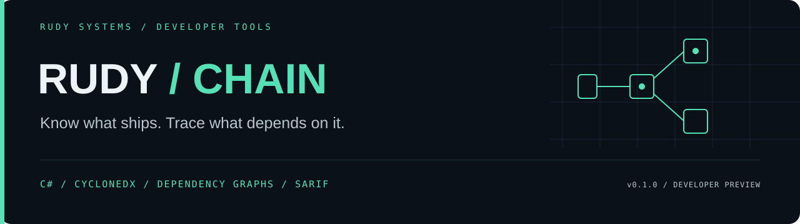

<p align="center"></p>

<p align="center">
  <a href="https://github.com/r4venrudy/rudy-chain/actions/workflows/ci.yml"></a>
  
  
  <a href="LICENSE"></a>
</p>

<p align="center"><strong>Know what ships. Trace what depends on it.</strong></p>
<p align="center"><a href="#what-it-does">Capabilities</a> · <a href="#build-and-install">Install</a> · <a href="#try-it">Examples</a> · <a href="docs/CONTRACT.md">Contract</a> · <a href="https://rudy.systems">Rudy Systems</a></p>

---

**Rudy Chain turns a software bill of materials into a reviewable dependency graph.**
Find the shortest declared path to a package, identify its reverse dependents,
inspect dependency cycles, compare two release inventories, and gate CI on explicit
supply-chain metadata policies. Everything runs locally in C#, with no third-party
runtime packages, network calls, package execution or external vulnerability feed.

**v0.1.0 developer preview.** This analyzes declarations in an SBOM. It does not
inspect package contents, authenticate publishers, discover CVEs, prove runtime
reachability or decide whether a dependency is exploitable. Missing graph records
are reported as **unknown**, not silently treated as complete leaves.

```text
CycloneDX JSON ──→ bounded importer ──→ dependency graph
                                             │
                   ┌─────────────────────────┼────────────────────┐
                   ▼                         ▼                    ▼
              why / impact              audit / policy       release diff
                   │                         │                    │
                   └────────────────── JSON / SARIF ───────────────┘
```

## What it does

| Capability | Implemented behavior |
| :--- | :--- |
| Dependency explanation | Deterministic breadth-first search returns a shortest root-to-component path |
| Impact analysis | Reverse traversal lists every declared transitive dependent, safely handling cycles |
| Cycle detection | Iterative strongly connected component analysis, including self-loops |
| Inventory comparison | Added, absent and changed package groups; version, scope, license, purl and digest changes; added/removed declared edges |
| Reference-independent diff | Changing `bom-ref` labels alone does not create package or edge changes |
| Policy checks | Missing versions, package URLs and strong digests; unknown dependency records; exact package/license deny lists |
| Contradiction detection | Identical package URL strings declaring conflicting digests for the same strong algorithm |
| CI output | Deterministic JSON or SARIF 2.1.0, rule IDs, fingerprints and configurable exit thresholds |
| Bounded input | 16 MiB documents, 10,000 components, 100,000 edges, depth/string/node limits and duplicate-property rejection |

The importer supports a **component-only subset of CycloneDX JSON 1.5, 1.6 and
1.7**, including nested component inventories. A root component with `bom-ref` is
required. Service graphs, external references used as graph targets, and `provides`
edges are rejected. This is not a full CycloneDX schema validator. See the
[supported contract](docs/CONTRACT.md) before integrating.

## Build and install

Requires the **.NET 10 SDK** to build, or the **.NET 10 runtime** to run a packaged
tool. C# keeps the graph engine, JSON parser, hashing and CLI in one portable,
strongly typed implementation. No Python or JavaScript wrapper is involved.

```sh
git clone https://github.com/r4venrudy/rudy-chain.git
cd rudy-chain
dotnet build tests/Rudy.Chain.Tests -c Release
dotnet run --project tests/Rudy.Chain.Tests -c Release --no-build -- .
dotnet pack src/Rudy.Chain.Cli -c Release -o artifacts
dotnet tool install Rudy.Chain.Tool --version 0.1.0 --tool-path .tools --add-source artifacts --configfile NuGet.Config
```

`NuGet.Config` clears external package sources; the projects have no package
dependencies. The installed command is `.tools/rudy-chain` on Linux/macOS or
`.tools/rudy-chain.exe` on Windows. Commands below use `rudy-chain` for readability;
substitute that path or add `.tools` to your PATH.

[GitHub releases](https://github.com/r4venrudy/rudy-chain/releases) provide the
installable `Rudy.Chain.Tool.0.1.0.nupkg` and a portable, framework-dependent ZIP.
The ZIP runs as `dotnet Rudy.Chain.Cli.dll --help` on a host with .NET 10. Verify
downloads against the release's `SHA256SUMS.txt`. The package is distributed through
GitHub releases; publication to nuget.org is not claimed.

## Try it

The bundled inventories and hash values are **synthetic**. The first inventory
declares `app → web → parser`. The second upgrades the parser, adds a helper without
a digest, and omits the helper's dependency record.

```sh
rudy-chain audit examples/before.cdx.json
rudy-chain why examples/before.cdx.json parser
rudy-chain impact examples/before.cdx.json parser
rudy-chain diff examples/before.cdx.json examples/after.cdx.json
rudy-chain audit examples/after.cdx.json --policy examples/policy.json
rudy-chain audit examples/after.cdx.json --format sarif --fail-on warning
```

The `why` result includes `["app", "web", "parser"]`. `impact` lists `app` and
`web`. The diff shows the parser's changed version/purl/digest declaration and the
added helper. The last two audit commands intentionally exit **1**: the policy
denies that helper, and the warning threshold catches missing metadata.

JSON goes to stdout; diagnostics go to stderr. Exit **0** means the command
completed without reaching its policy threshold, **1** means the threshold was
reached, and **2** means invalid input, usage or I/O failure. The default audit
threshold is `error`; use `--fail-on warning` for metadata gates or `--fail-on none`
for collection only. Notes alone do not fail a gate.

### Supply your policy

```json
{
  "requireStrongHash": true,
  "requireVersion": true,
  "requirePurl": true,
  "requireKnownDependencies": true,
  "deniedPurls": ["pkg:generic/example-helper@0.9.0"],
  "deniedLicenseValues": []
}
```

Policy keys are strict; typos are rejected. Omitted boolean settings default to
`true`. Deny lists match exact, case-sensitive strings. `deniedLicenseValues`
compares a **whole** declared license ID, name or expression; it does not parse
SPDX expressions, evaluate `AND`/`OR`/exceptions, or provide legal advice. For
example, denying `GPL-3.0-only` does not match `MIT OR GPL-3.0-only`; list the
complete expression to block it. There is no semantic version range matching or
package URL canonicalization.

### CI integration

```sh
rudy-chain audit your-bom.cdx.json --policy policy.json --format sarif --fail-on warning > chain.sarif
```

Your CI must retain the command's exit code. A threshold failure still emits the
complete report. Uploading SARIF is a separate CI step. Findings are inventory
observations, not source-line diagnostics; SARIF contains component references
and dependency paths in result properties, without invented file locations.

## Validation and architecture

The dependency-free C# regression runner covers input rejection, shortest paths,
reverse impact, cycles, policy failures, diff semantics, SARIF and actual CLI
processes. It also compares 100 seeded random graphs against an independently
implemented transitive-closure oracle, and exercises a 10,000-node chain to check
that graph traversal does not depend on the process call stack.

CI runs the same runner on Linux, Windows and macOS, then builds and smoke-tests
the .NET tool package. Release automation repeats those gates before packaging.
See [validation](docs/VALIDATION.md) for recorded local results and how to reproduce
them. A configured workflow is not proof of a successful run; use the live badge.

```text
src/Rudy.Chain.Core/    Importer, graph algorithms, policy, diff and SARIF
src/Rudy.Chain.Cli/     CLI and installable .NET tool
tests/Rudy.Chain.Tests/ Regression runner, independent graph oracle and CLI tests
examples/              Synthetic before/after inventories and policy
docs/CONTRACT.md       Supported fields, semantics, limits and rule IDs
```

Input order is normalized for components, edges, licenses and hashes. Reports
include SHA-256 of the original bytes, so formatting changes alter the input
digest even when the semantic diff is empty. All inventory variants are retained
within each `(type, group, name)` package group. Those fields can collide in weak
inventories; review groups rather than treating them as authenticated identities.

Unknown dependencies can hide real paths and dependents. Component containment
does not imply a dependency. Audits report all components, including optional and
excluded scopes; they do not infer what is installed in production.

See [security boundaries](SECURITY.md) and [contributing](CONTRIBUTING.md).
Specification references: [CycloneDX dependency semantics](https://cyclonedx.org/use-cases/software-dependencies/),
[JSON reference](https://cyclonedx.org/docs/1.7/json/) and
[.NET tool packaging](https://learn.microsoft.com/en-us/dotnet/core/tools/global-tools-how-to-create).

---

<p align="center"><a href="LICENSE">MIT licensed</a> · Built by <a href="https://rudy.systems">Rudy Systems</a> · <a href="https://github.com/r4venrudy">r4venrudy</a></p>

### License metadata gate

Set `"requireLicense": true` in your policy to flag components without any license
declaration (CHAIN010, warning). This optional flag defaults to false; the original
requirement flags still default to true. A declared value is metadata, not a license
compliance decision. Use `--fail-on warning` to enforce it in CI.

### Component type policy

`"deniedComponentTypes": ["file"]` rejects exact declared component types with
CHAIN011 (error). The list defaults to empty and applies to the root as well as
other components. Matching is case-sensitive and does not infer a type from names.
